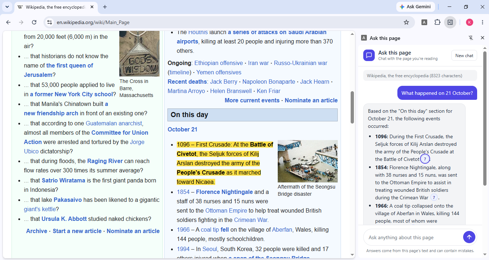
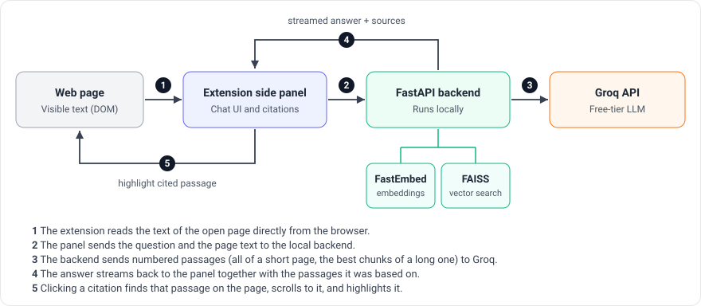

# Ask this page

A Chrome extension that lets you chat with the web page you are reading. Open any page, open the side panel, and ask questions. Answers are based only on the page, and every statement links back to the passage it came from.





<!-- Add the demo video link here once it is recorded -->

## Features

- **Ask questions about any page** and get streamed answers.
- **Citations you can click.** Each answer carries numbered chips. Clicking one scrolls to the supporting sentence on the page and highlights it.
- **Works on long pages.** Pages that do not fit in one prompt are split into chunks, embedded locally, and searched, so only the relevant parts are sent to the model.
- **Summarize and Key points** starter buttons that cover the whole page, not just the start.
- **Follow-up questions** with short conversation memory.
- **Formatted answers** (bold, italics, lists), a Stop button, a Copy button, and a New chat button.
- **Light and dark theme**, following your browser.

## How it works



1. A script injected by the extension reads the text of the open tab, so it also works on pages that need a login or are built with JavaScript.
2. The side panel sends the question and the page text to a small FastAPI backend running on your machine.
3. Short pages are sent whole. Long pages are split into chunks, embedded with FastEmbed, and searched with FAISS to find the most relevant chunks. Summary requests use chunks spread across the whole page instead.
4. The passages are numbered and sent to the Groq API. The model is told to answer only from them and to cite passage numbers.
5. The answer streams back with its source passages. The panel turns each number into a chip that locates the passage on the page.

## Tech stack

- **Extension:** Chrome Manifest V3, side panel, vanilla JavaScript
- **Backend:** Python, FastAPI, streaming responses
- **Retrieval:** LangChain text splitters, FastEmbed (local embeddings), FAISS
- **LLM:** Groq API (free tier)

## Getting started

### Prerequisites

- Google Chrome on desktop
- Python 3.10 or newer
- A free Groq API key from the Groq console

### 1. Clone the repository

```
git clone https://github.com/KenilBhadani/ask-this-page.git
cd ask-this-page
```

### 2. Set up and start the backend

```
cd backend
python -m venv .venv
.venv\Scripts\activate          # Windows
source .venv/bin/activate       # macOS / Linux
pip install -r requirements.txt
```

Create your settings file from the example and add your key:

```
copy .env.example .env          # Windows
cp .env.example .env            # macOS / Linux
```

Open `backend/.env` and set `GROQ_API_KEY` and `GROQ_MODEL`. Model names on Groq change over time, so pick a chat model that your key can use from the model list in the Groq console.

Start the server and leave it running:

```
uvicorn app.main:app --reload
```

The first question on a long page downloads the small embedding model once, so it takes a little longer.

### 3. Load the extension

1. Open `chrome://extensions` and turn on **Developer mode**.
2. Click **Load unpacked** and select the `extension` folder.
3. Pin the extension from the puzzle-piece menu.

### 4. Use it

Open a regular website, click the extension icon, and ask a question or press **Summarize this page**. Click a numbered chip to see where an answer came from.

## Configuration

Set in `backend/.env`:

| Variable | Purpose |
| --- | --- |
| `GROQ_API_KEY` | Your Groq API key |
| `GROQ_MODEL` | The Groq chat model to use |

Tuning values live in `backend/app/config.py`: `MAX_PAGE_CHARS` (pages up to this size are sent whole), `CHUNK_SIZE`, `CHUNK_OVERLAP`, `TOP_K` (chunks sent for long pages), and `SUMMARY_CHUNKS`.

## Project structure

```
ask-this-page/
  extension/     Chrome extension: side panel UI, page reader, citation highlighting
  backend/
    app/
      main.py    FastAPI routes and response streaming
      rag.py     Chunking, embeddings, vector search
      llm.py     Prompt building and the Groq call
      config.py  Settings
  docs/          Architecture diagram and screenshots
```

## Privacy

- The text of the page you ask about is sent to your local backend and then to the Groq API. Avoid using the extension on pages with sensitive information.
- Your API key stays in `backend/.env` and is never part of the extension. `.env` is excluded from git.
- This app does not save conversations. The chat lives in the side panel and is cleared when it closes. The backend keeps a temporary search index of recently read long pages in memory, which is lost when the server restarts.

## Limitations

- Desktop Chrome only. Chrome for Android does not support extensions.
- Pages that load more content as you scroll may not be fully available until that content appears.
- Citation highlighting finds the first match of the cited sentence on the page. If the page changes its text (for example, with CSS capitalization), the match can fail.
- Pages shown in Chrome's PDF viewer and chrome:// pages cannot be read.
- Free-tier rate limits apply, and Groq model names change over time.
- Built as a personal project and run locally. It is not published to the Chrome Web Store.

## Troubleshooting

- **"Can't reach the backend":** the server is not running. Start it with `uvicorn app.main:app --reload` from the `backend` folder with the virtual environment active.
- **"Model not found":** the model in `GROQ_MODEL` is not available to your key. Choose another chat model from the Groq console, update `.env`, and restart the server.
- **"This page can't be read":** extensions cannot access chrome:// pages or the Chrome Web Store. Try a regular website.

## Roadmap

- [x] Side panel that reads the text of the current page
- [x] FastAPI backend with a health check
- [x] Chat box in the panel connected to the backend
- [x] LLM integration
- [x] Streaming answers
- [x] Retrieval for long pages (chunking, embeddings, vector search)
- [x] Source citations with highlighting on the page
- [x] Formatted answers with clickable source chips
- [x] Follow-up questions and a New chat button
- [x] Starter prompts, stop and copy buttons, loading and error states
- [ ] Saved chat history per page
- [ ] Settings page for the backend URL and model
- [ ] PDF support
- [ ] Auto-scroll for pages that load content lazily

## License

MIT. See [LICENSE](LICENSE).